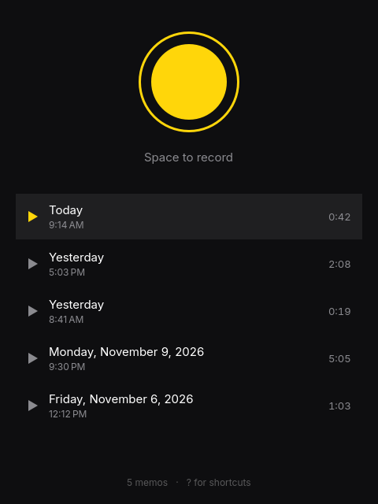

# Memo



Record voice memos with one key. Press Space to start, Space to stop. That's it.

Memos land in `~/Music/Memos` as Opus files named after when you started
talking (`2026-11-12 18-58-03.ogg`), so the folder is the app: sync it, back it
up, or drop audio files in and they show up. Drag a memo out of the window to
attach it anywhere. Deleting asks first (Enter or D again to confirm), moves it
to the trash, and Ctrl+Z brings it back.
Closing the window mid-memo saves what you have.

## Transcripts

Press T and [Superwhisper](https://superwhisper.com) turns the memo into text,
saved beside it with the same name (`2026-11-12 18-58-03.txt`). The folder
keeps the history: every memo and its words, as plain files any editor or
`grep` can read. C copies the transcript, and deleting a memo takes its
transcript to the trash with it.

Memo says what's missing when Superwhisper isn't installed or its speech model
isn't downloaded, and in Cloud mode it asks before uploading anything.
Everything else works without it.

Follows the Omarchy theme accent, window rounding, and language, live, in all
50 of Omarchy's languages.

## Install

On Omarchy (or any Arch system with Qt 6.8+):

```sh
git clone https://github.com/WilliamJohnDavisIII/memo
cd memo
bin/install
```

Memo then shows up in the app launcher (Super + Space).

## Shortcuts

| Key | Action |
| --- | --- |
| Space | Record / stop |
| Enter | Play / pause |
| ↑ ↓ or J K | Select |
| ← → or H L | Skip 5 seconds |
| T | Transcribe |
| C | Copy transcript |
| D, Delete, Backspace | Move to trash |
| Ctrl+Z / Ctrl+Shift+Z | Undo / redo |
| O | Open the memos folder |
| ? | Show shortcuts |
| Q | Quit |

## Command line

```sh
memo                 # open the recorder
memo list [--json]   # memos, newest first, with durations and transcripts
memo dir             # the memos folder
```

## Build

```sh
bin/build     # build/memo
bin/test      # backend, theme, and translation tests
bin/install   # package and install, so it shows up in the launcher
```

Needs `qt6-base`, `qt6-declarative`, `qt6-multimedia` with the FFmpeg backend,
and `ffmpeg`, all part of Omarchy.

## License

MIT. Theme and language following come from Omacut and Monologue by David
Heinemeier Hansson.
